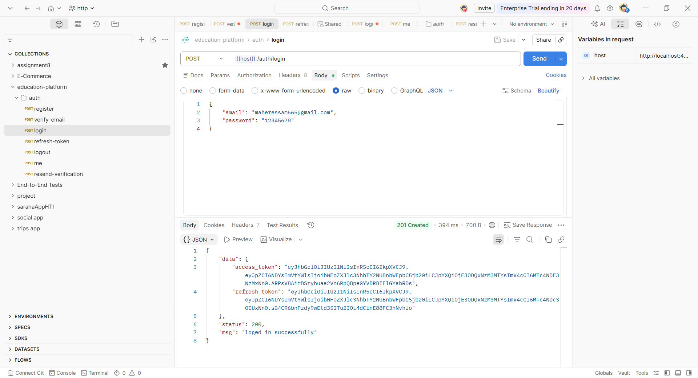
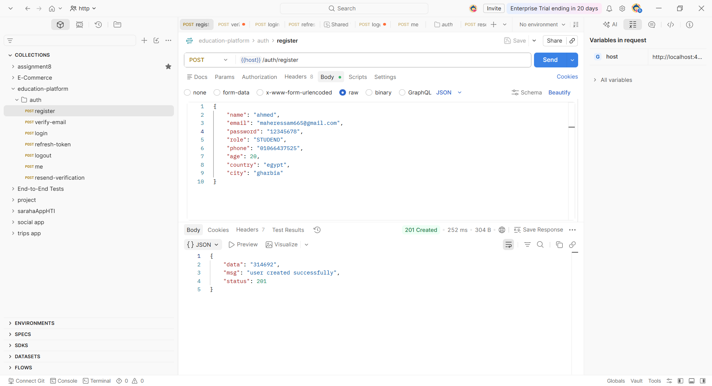
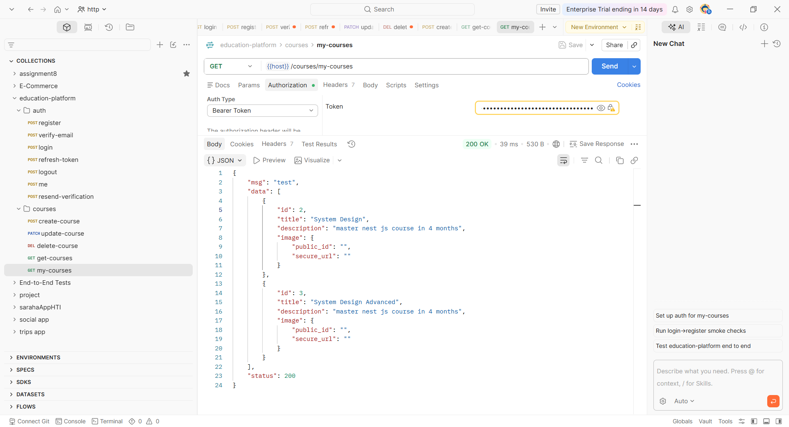
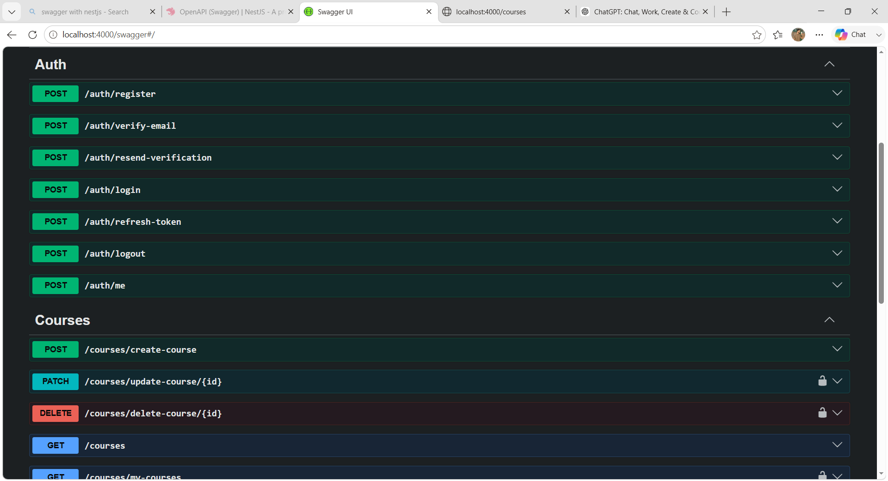
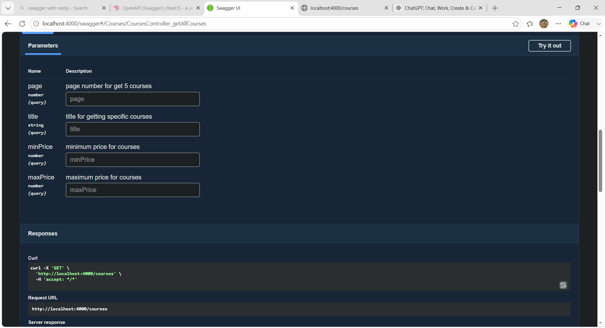

<p align="center">
  <a href="http://nestjs.com/" target="blank"></a>
</p>

[circleci-image]: https://img.shields.io/circleci/build/github/nestjs/nest/master?token=abc123def456
[circleci-url]: https://circleci.com/gh/nestjs/nest

  <p align="center">A progressive <a href="http://nodejs.org" target="_blank">Node.js</a> framework for building efficient and scalable server-side applications.</p>
    <p align="center">
<a href="https://www.npmjs.com/~nestjscore" target="_blank"></a>
<a href="https://www.npmjs.com/~nestjscore" target="_blank"></a>
<a href="https://www.npmjs.com/~nestjscore" target="_blank"></a>
<a href="https://circleci.com/gh/nestjs/nest" target="_blank"></a>
<a href="https://discord.gg/G7Qnnhy" target="_blank"></a>
<a href="https://opencollective.com/nest#backer" target="_blank"></a>
<a href="https://opencollective.com/nest#sponsor" target="_blank"></a>
  <a href="https://paypal.me/kamilmysliwiec" target="_blank"></a>
    <a href="https://opencollective.com/nest#sponsor"  target="_blank"></a>
  <a href="https://twitter.com/nestframework" target="_blank"></a>
</p>
  <!--[](https://opencollective.com/nest#backer)
  [](https://opencollective.com/nest#sponsor)-->

## Description

[Nest](https://github.com/nestjs/nest) framework TypeScript starter repository.

## Project setup

```bash
$ npm install
```

## Compile and run the project

```bash
# development
$ npm run start

# watch mode
$ npm run start:dev

# production mode
$ npm run start:prod
```

## Run tests

```bash
# unit tests
$ npm run test

# e2e tests
$ npm run test:e2e

# test coverage
$ npm run test:cov
```

## Deployment

When you're ready to deploy your NestJS application to production, there are some key steps you can take to ensure it runs as efficiently as possible. Check out the [deployment documentation](https://docs.nestjs.com/deployment) for more information.

If you are looking for a cloud-based platform to deploy your NestJS application, check out [Mau](https://mau.nestjs.com), our official platform for deploying NestJS applications on AWS. Mau makes deployment straightforward and fast, requiring just a few simple steps:

```bash
$ npm install -g @nestjs/mau
$ mau deploy
```

With Mau, you can deploy your application in just a few clicks, allowing you to focus on building features rather than managing infrastructure.

## Resources

Check out a few resources that may come in handy when working with NestJS:

- Visit the [NestJS Documentation](https://docs.nestjs.com) to learn more about the framework.
- For questions and support, please visit our [Discord channel](https://discord.gg/G7Qnnhy).
- To dive deeper and get more hands-on experience, check out our official video [courses](https://courses.nestjs.com/).
- Deploy your application to AWS with the help of [NestJS Mau](https://mau.nestjs.com) in just a few clicks.
- Visualize your application graph and interact with the NestJS application in real-time using [NestJS Devtools](https://devtools.nestjs.com).
- Need help with your project (part-time to full-time)? Check out our official [enterprise support](https://enterprise.nestjs.com).
- To stay in the loop and get updates, follow us on [X](https://x.com/nestframework) and [LinkedIn](https://linkedin.com/company/nestjs).
- Looking for a job, or have a job to offer? Check out our official [Jobs board](https://jobs.nestjs.com).

## Discription
E-Learning Platform Backend (NestJS) 🚀
مستودع الكود الخاص بالـ Backend لمنصة التعليم الإلكتروني متعددة المحاضرين، تم بناؤه باستخدام NestJS كإطار عمل متكامل، مرن، وقابل للتوسع (Scalable).


🏗️ بنية المشروع والـ Modules الأساسية
تم تقسيم النظام إلى موديولات مستقلة لضمان سهولة الصيانة والتطوير (Modular Architecture):
1. Auth & Users Module
نظام تسجيل الدخول وإدارة الصلاحيات باستخدام JWT و Passport.
دعم الأدوار المختلفة في النظام باستخدام Decorators مخصصة: [Admin, Instructor, Student].

<>
<>

2. Courses Module
للمحاضرين: إنشاء الكورسات، تقسيمها إلى فصول (Sections) ودروس (Lectures)، ورفع ملفات الـ PDF.
للإدارة: مراجعة الكورسات وتغيير حالتها إلى Approved أو Rejected.
للطلاب: استعراض الكورسات وتتبع نسبة التقدم (Progress Tracking).



##############################################

  -- Adding Swagger UI for the project 

  
  

##############################################

  -- Docker Desktop 
  

##############################################

3. Video Module (VdoCipher Integration)
التكامل مع API الخاص بـ VdoCipher لتوليد روابط تشغيل آمنة ومشفرة (OTP/Playback) تمنع تحميل الفيديوهات أو تسريبها.

<<<<<<< HEAD
  

=======

>>>>>>> 5f3c55e14d79de7a2615b1ba2c154201df304151

4. Section Module (Completed Before Payments)
تمت إضافة وحدة Sections كطبقة تنظيمية أساسية داخل كل كورس، وركزت على بناء هيكلية تعليمية منطقية قبل الانتقال إلى الدفع والاشتراكات. تم إنشاء الـ Entity الخاص بالـ Section وربطه بـ Course، مع إعداد ترتيب فريد لكل قسم داخل الكورس باستخدام الحقل order، بالإضافة إلى ربطه بـ Lessons بحيث يمكن لكل قسم أن يحتوي على مجموعة من الدروس.

تم تنفيذ كامل الـ CRUD الخاص بالـ Sections، بما في ذلك:
- إنشاء قسم جديد داخل كورس معين.
- تحديث عنوان/وصف/ترتيب القسم.
- حذف القسم مع الحفاظ على سلامة العلاقات داخل قاعدة البيانات.
- جلب كل الأقسام الخاصة بالكورس.
- جلب قسم محدد حسب ترتيب القسم داخل الكورس.

كما تم تطبيق قواعد الأمان والـ Validation بشكل عملي:
- التحقق من صلاحية CourseId و SectionId قبل تنفيذ أي عملية.
- منع تكرار اسم القسم داخل نفس الكورس.
- التأكد من أن المستخدم صاحب الصلاحية هو instructor أو admin فقط.
- تنظيم الأقسام حسب order ASC لعرض منظم ومنطقي في الواجهة أو في API.

هذه الوحدة كانت خطوة مهمة جدًا لأنها مهدت الطريق لبنية المنصة بشكل صحيح: Course -> Section -> Lesson -> Video، وهو الهيكل المطلوب لتوسيع المشروع لاحقًا نحو Payments و Wallets.


5. Payments Module (Stripe & Dynamic Pricing)
Stripe Integration: معالجة عمليات الدفع والاشتراكات.
Dynamic Pricing Guard: الـ Middleware بيحدد الـ IP الخاص بالطلب لمعرفة الدولة، وبناءً عليه بيتم تطبيق السعر المخصص (داخل مصر / خارج مصر).
Refund Guard: نظام حماية يمنع استرداد الأموال (Refund) إذا تخطى تقدم الطالب في الكورس نسبة 25% (يتم التحقق منها عبر قاعدة البيانات قبل إتمام طلب الاسترداد).


6. Wallets & Commissions Module
حساب النسب تلقائياً: عند شراء أي كورس، يقوم الـ Service بتقسيم المبلغ برمجياً: 60% لمحفظة المحاضر و 40% لمحفظة المنصة.
Withdrawal System: نظام لإدارة طلبات السحب، حيث يتم التحقق من أن رصيد المحاضر يتخطى الحد الأدنى المسموح به قبل تحويل حالة الطلب إلى Approved.
🛠️ التقنيات المستخدمة (Tech Stack)
Framework: NestJS (TypeScript)
Database ORM: TypeORM ( PostgreSQL)
Security: Helmet, bcrypt, Passport-JWT
Third-Party APIs: Stripe SDK, VdoCipher API

## Support

Nest is an MIT-licensed open source project. It can grow thanks to the sponsors and support by the amazing backers. If you'd like to join them, please [read more here](https://docs.nestjs.com/support).

## Stay in touch with me

- Author - [Ahmed Elsaid Bedir]
- Website - [https://a7medbedir22.lovable.app/]

## License

Nest is [MIT licensed](https://github.com/nestjs/nest/blob/master/LICENSE).
